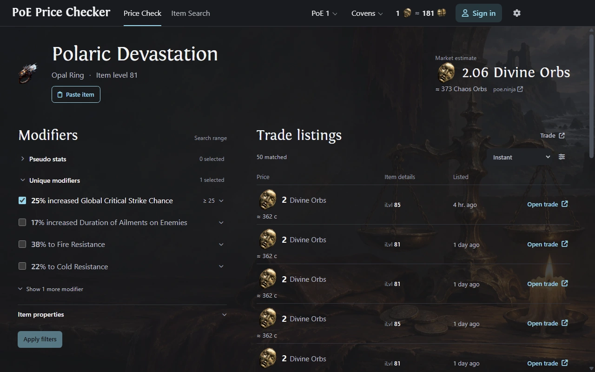
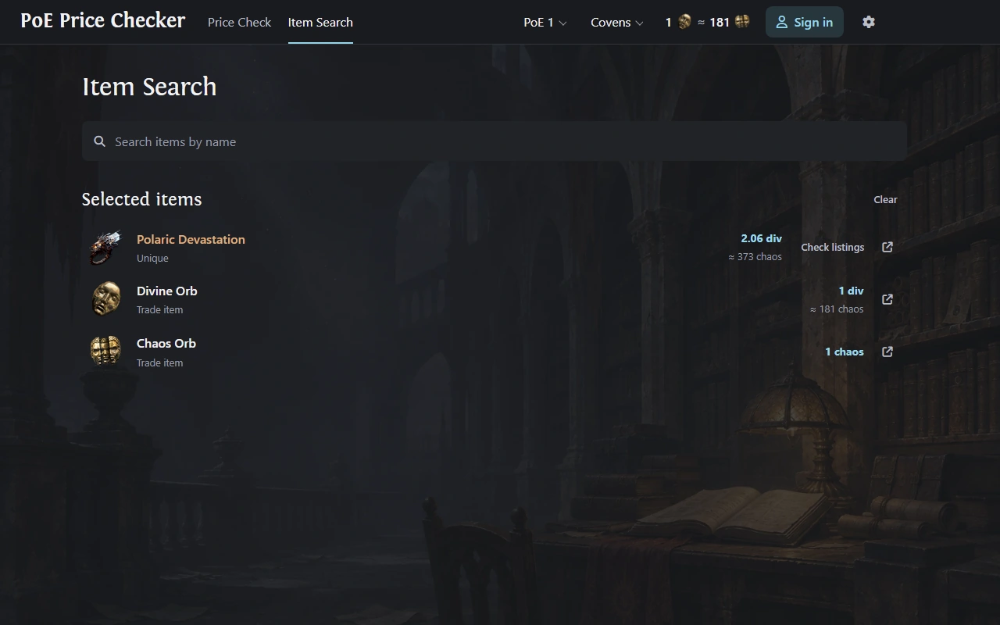
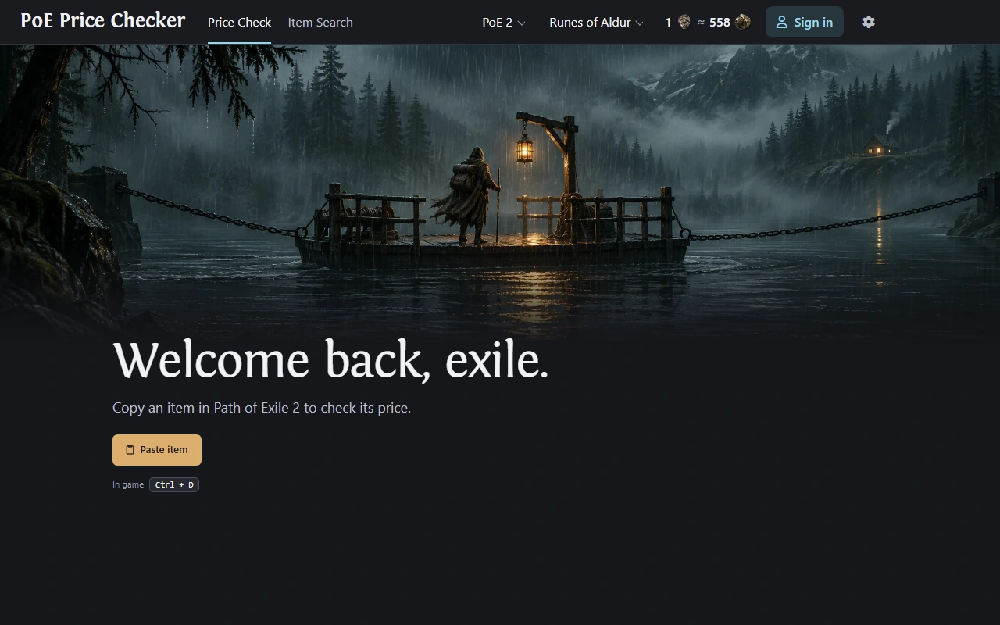

#  PoE Price Checker

**A free, open-source item price checker for Path of Exile 1 (PoE1) and Path of Exile 2 (PoE2).** Hover over an item and press **Ctrl+D** to compare its rolls with trade listings for your league. The price checker opens in its own Windows desktop window.

[**Download for Windows x64**](https://github.com/CyanBalloon/poe-price-checker/releases/download/v1.1.11/poe-price-checker-setup-1.1.11.exe) · [Portable edition](https://github.com/CyanBalloon/poe-price-checker/releases/download/v1.1.11/poe-price-checker-1.1.11.exe) · [Website](https://poe2pricechecker.com/) · [v1.1.11 release notes](https://github.com/CyanBalloon/poe-price-checker/releases/tag/v1.1.11)

[](docs/public/images/poe1-price.webp)

*Polaric Devastation in PoE1. Market values in these screenshots reflect the league at the time of capture.*

## Your first price check

1. Run the installer, or open the portable executable directly. Choose **PoE 1** or **PoE 2** at the top right, then select your league.
2. Hover over an item in game and press **Ctrl+D**. If you already have the item text, use **Paste item** in the app.
3. Exchange items open in **Item Search** with the item selected. For gear, expand a modifier group, select the rolls you want to match, and apply the filters. Open **Trade** to see the search on the official trade site.

For a worked example, follow the [PoE1 guide to chaos, divines and modifier filters](https://poe2pricechecker.com/poe1-price-checker/) or the [PoE2 guide to checking gear and looking up uniques](https://poe2pricechecker.com/poe2-price-checker/).

Open **Settings → Application** to check for updates, download them, and restart. The installed and portable Windows editions both update in place. Turn off **Automatic updates** to choose when to download. Portable users on v1.1.1 or earlier need to replace their executable once to get the in-app updater.

## What changes when you switch games?

| | Path of Exile 1 | Path of Exile 2 |
| --- | --- | --- |
| Prices | Estimates below one Divine Orb use chaos. At one Divine Orb or more, the divine price comes first with its chaos equivalent underneath. | Uses the PoE2 economy and exchange rates for the selected league. |
| Items and artwork | PoE1 base types, uniques, currency icons and Lioneye’s Watch. | PoE2 item data, currency icons and The Lantern Crossing. |
| Trade | Searches the PoE1 PC market. | Searches the PoE2 market. |

Each game remembers its own league. In **Price Check**, collapsed modifier groups show how many stats you have selected. Crafted and fractured groups appear when the item has those modifiers. In **Item Search**, you can keep several items in view and open listings for any of them.

| Item Search in PoE1 | The Lantern Crossing in PoE2 |
| --- | --- |
| [](docs/public/images/poe1-search.webp) | [](docs/public/images/poe2-welcome.webp) |

All three screenshots were captured from the packaged Windows build. Select one to open it at full size.

## Language and settings

On Windows, the **Auto-clicker** switch is under **Settings → Shortcuts**. It starts off for fresh installs and upgrades from v1.1.0. Enabling it requires confirming a warning about the Path of Exile Terms of Use.

PoE1 includes clipboard data for English, Russian, Traditional Chinese and Korean. Choose the matching client language in **Settings**. Other PoE1 language selections use the English data. Closing the window leaves the app in the system tray. Choose **Quit** from its tray menu to exit.

## Run from source

With Node.js 24 installed, clone the repository and launch the development build from PowerShell.

```powershell
git clone https://github.com/CyanBalloon/poe-price-checker.git
cd poe-price-checker
.\dev_standalone.bat
```

The launcher installs dependencies on first use. For production packaging and the website preview, see the [development guide](DEVELOPING.md).

## Credits

This project builds on [Exiled Exchange 2](https://github.com/Kvan7/Exiled-Exchange-2) and [Awakened PoE Trade](https://github.com/SnosMe/awakened-poe-trade). Trade listings come from the official Path of Exile trade service, and market estimates come from [poe.ninja](https://poe.ninja/). Path of Exile and its game artwork belong to Grinding Gear Games. The project code is available under the [MIT license](LICENSE).

The app logo uses Grinding Gear Games’ [Mageblood inventory artwork](https://web.poecdn.com/image/Art/2DItems/Belts/InjectorBelt.png).
