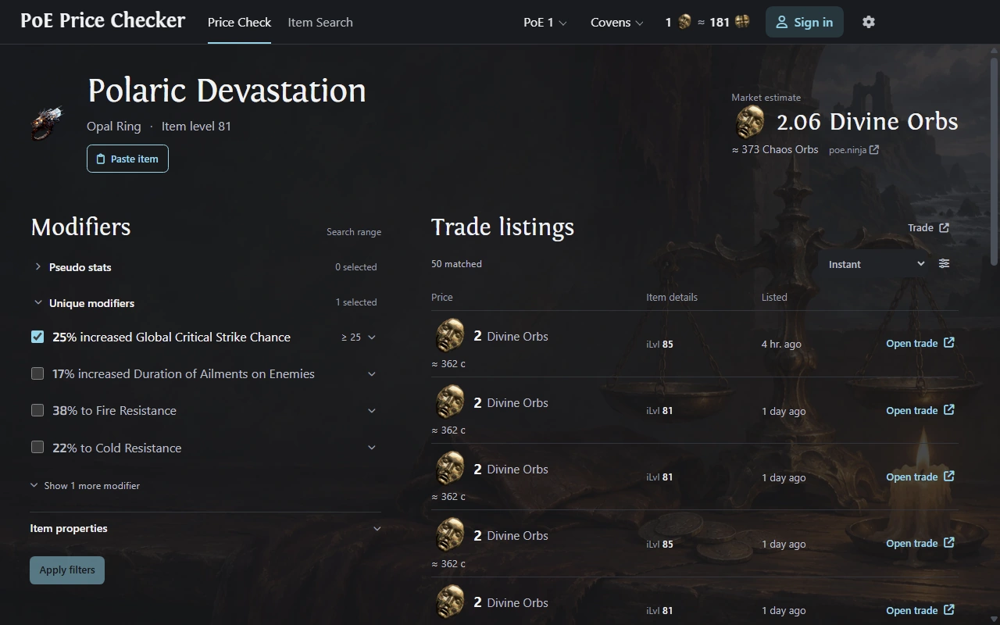

## Path of Exile 1 is now supported

PoE Price Checker v1.1.0 brings PoE1 and PoE2 into one Windows desktop app. Select your game and league in the top-right corner, hover over an item, and press **Ctrl+D**.

- **PoE1 pricing** shows chaos for cheaper items and divines first for items worth at least one Divine Orb. The chaos equivalent appears underneath.
- **Price Check** groups modifiers by source and shows how many are selected. Pseudo stats start folded. Crafted and fractured modifiers get their own groups when present.
- **Item Search** shows the selected game’s items, artwork and league prices. Each game remembers its own league.
- **The redesigned window** gives both games a borderless toolbar, game-specific welcome art, and quieter backgrounds behind searches and listings.

### Windows x64 downloads

- [Installer](https://github.com/CyanBalloon/poe-price-checker/releases/download/v1.1.0/poe-price-checker-setup-1.1.0.exe) for a standard installation.
- [Portable executable](https://github.com/CyanBalloon/poe-price-checker/releases/download/v1.1.0/poe-price-checker-1.1.0.exe) to launch directly.

The project is now named **poe-price-checker**. Existing Windows installations keep their saved preferences and sign-in profile.
